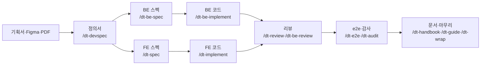

# dt-development

기획부터 코드, 리뷰, 마무리(문서·이슈 정리)까지 — 웹 서비스 개발의 한 흐름 전체를 정해진 방식대로 자동화하는 Claude Code 플러그인입니다.

프론트엔드(React 5계층)와 백엔드(NestJS 계층형) 양쪽에서, 코드를 만들 때마다 정해진 아키텍처를 따르고 자동으로 검증되도록 설계했습니다. 사람이 매번 규칙을 기억하지 않아도 늘 같은 구조·같은 품질로 결과물이 나오는 것이 목표입니다.

팀마다 다른 것(이슈 트래커, 위키, git 흐름, ORM·DB, 폴더 구조)은 설정 파일로 고릅니다. 설정을 하나도 안 만들어도 기본값으로 바로 동작합니다.

---

## 설치

Claude Code 세션 안에서 다음 두 명령을 입력합니다(터미널이 아닙니다).

```
/plugin marketplace add CommandarCSP/dt-development
/plugin install dt-development@dt-development
```

새 버전이 나오면 `/plugin` 메뉴에서 업데이트하고 Claude Code를 다시 시작합니다. 버전마다 바뀐 점과 올릴 때 할 일은 [CHANGELOG](CHANGELOG.md)에 있습니다.

---

## 지원 범위

아래 범위에서 만들고 검사합니다. 표에 없는 스택(예: Vue, Spring)은 스펙 작성·문서·작업 기록처럼 코드를 만들지 않는 기능만 쓸 수 있습니다.

| 영역 | 지원 | 고르는 곳 |
|---|---|---|
| 프론트엔드 | React + Vite. 스타일링은 Tailwind(기본)·CSS 변수·SCSS | 스택 설정 `.dt-frontend.json` |
| 백엔드 | NestJS. ORM은 Prisma(기본)·TypeORM(Drizzle은 리뷰 규칙만), DB는 PostgreSQL(기본)·MySQL | 스택 설정 `.dt-backend.json` |
| 패키지 관리자·테스트 | pnpm·npm·yarn, Vitest·Jest, e2e는 Playwright(FE)·Supertest + Testcontainers(BE) | 스택 설정(없으면 lockfile·package.json으로 판단) |
| 이슈 트래커 | Jira(연동) · 없음. GitHub·Linear는 자리만 있고 아직 연동하지 않음 | `.dt.json` `tracker` |
| 위키 | Confluence(연동) · 저장소 markdown(`docs/wiki/`) · 없음. Notion은 자리만 있음 | `.dt.json` `wiki` |
| 기획·디자인 입력 | Figma · Notion · Confluence · PDF · Markdown · 웹 링크. Figma 없이도 됨 | 명령 인자 |
| git 흐름 | 기준 브랜치(main·develop 등), 합치는 방식 `no-ff`(기본)·`squash`·`rebase`·`pr` | `.dt.json` `gitFlow` |

**필요한 것**
- Claude Code, Node 18 이상.
- 연동을 쓸 때만 해당 MCP가 필요합니다: Figma MCP(Figma 입력), Atlassian MCP(Jira·Confluence), Notion MCP(Notion 입력). 없으면 그 기능만 건너뛰거나 웹 링크·붙여 넣기로 대신합니다.
- 가이드·핸드북 PDF와 FE e2e를 쓸 때는 대상 프로젝트에 Playwright, BE e2e를 쓸 때는 Docker가 필요합니다.
- 산출물 언어는 지금 한국어만 지원합니다.

---

## 빠른 시작

상황에 맞는 첫 명령 하나만 고르면 됩니다. 명령마다 필요한 값은 질문으로 받고, 파일을 쓰기 전에 미리보기를 보여 줍니다.

| 상황 | 이렇게 시작 | 무엇이 생기나 |
|---|---|---|
| 새 서비스를 기획서부터 만든다 | `/dt-devspec <기획서·Figma 링크>` → `/dt-fullstack` | 정의서 → BE·FE 스펙 → 코드 → (선택) e2e·감사·문서 |
| 화면 하나·API 하나만 만든다 | `/dt-spec <소스>` → `/dt-implement` · `/dt-be-spec <소스>` → `/dt-be-implement` | 그 단위의 스펙과 코드 |
| 이미 만든 프로젝트를 들인다 | `/dt-adopt` | 코드에서 뽑은 정의서·스펙·결정 기록 초안(의도/버그를 묻고 확정) |
| 코드 규칙만 검사한다 | `/dt-review` · `/dt-be-review` | 규칙 위반·커버리지 보고서 |
| 인수인계 문서가 필요하다 | `/dt-handbook` | 개발자 핸드북 PDF(`docs/handbook/`) |
| 사용자 가이드가 필요하다 | `/dt-guide` | 사용자 가이드 PDF(`docs/guide/`) |
| 하루 작업을 정리한다 | `/dt-wrap` | 커밋 → 위키 문서 판단 → 작업 기록(Jira) |
| 피처 브랜치를 합친다 | `/dt-git start` · `/dt-git finish` | 기준 브랜치에서 분기 → 리베이스·머지·push |

팀 설정을 한 번에 만들려면 `/dt-wrap --init`을 씁니다. 트래커·위키를 쓰는지 묻고 `.dt.json`을 만듭니다.

---

## 전체 흐름

`/dt-fullstack`은 아래 단계에 이름을 붙여 차례로 실행합니다. 단계마다 확인을 받고, 중간에 끊기면 진행 기록에서 이어 갑니다. 각 단계는 따로 불러도 됩니다.



- **정의서가 기준입니다.** FE·BE가 나눠 맡을 범위와 주고받을 인터페이스(IF)를 먼저 합의하고, 스펙은 그 정의서 버전에 묶입니다. 정의서가 바뀌면 어느 스펙이 영향을 받는지 계산해 보여 줍니다.
- **스펙은 SDD(스펙 주도 개발) 형식입니다.** 요구사항은 EARS(정해진 틀로 쓰는 요구사항 문장) 형식으로 쓰고, 설계·작업 목록·API 계약은 파일을 따로 둡니다. 모르는 값은 지어내지 않고 묻습니다.
- **코드는 계획(plan) → 구현 → 단계별 리뷰 순서로 만듭니다.** 판단이 필요한 계획은 강한 모델이, 기계적인 구현은 빠른 모델이 맡습니다(`.dt.json` `team.models`로 바꿀 수 있습니다).

---

## 산출물 지도

플러그인이 여러분 프로젝트에 남기는 파일입니다. 같은 파일을 두 스킬이 쓰지 않도록 쓰는 쪽이 정해져 있습니다([`docs/refs/artifact-contract.md`](docs/refs/artifact-contract.md)).

| 경로 | 무엇 | 만드는 명령 |
|---|---|---|
| `docs/specs/definition.md` | 정의서 — FE·BE 범위 분담과 인터페이스 합의 | `/dt-devspec` · `/dt-adopt` |
| `docs/specs/pages/<화면>/` | FE 스펙(requirements·design·tasks·layout-skeleton)과 구현 계획 `plan.md` | `/dt-spec` · `/dt-implement` |
| `docs/specs/resources/<리소스>/` | BE 스펙(requirements·design·tasks·api-contract)과 `plan.md` | `/dt-be-spec` · `/dt-be-implement` |
| `docs/specs/interactions.md` | 화면 사이·리소스 사이 상호작용(FE 절·BE 절을 각자 씀) | 스펙 명령 |
| `docs/specs/**/*.e2e-scenarios.md` | e2e 시나리오 원장 | `/dt-e2e` · `/dt-be-e2e` |
| `docs/project-context.md` | 프로젝트 개요·기술 스택·디자인 토큰·공유 규약·도메인 용어 | 스펙 명령이 절마다 채움 |
| `docs/decisions/PD-*.md` | 프로젝트 결정 기록 | `/dt-decision` · `/dt-adopt` |
| `docs/audits/` | 감사 보고서·후속 기록 | `/dt-audit` |
| `docs/handbook/` · `docs/guide/` | 핸드북·가이드 원고·그림·PDF·영수증 | `/dt-handbook` · `/dt-guide` |
| `docs/wiki/` | 위키 문서(`wiki: markdown`일 때) | `/dt-confluence` |
| `.dt-*` 폴더(`.dt-spec/`·`.dt-devspec/`·`.dt-impl/`·`.dt-adopt/` 등) | 작업 중 임시 파일 — 재개용, 커밋하지 않음 | 각 명령 |

---

## 무엇이 들어 있나

스킬 38개 · 에이전트 16개 · 명령 23개로 이루어져 있습니다. 갈래로 묶으면 다음과 같습니다.

| 갈래 | 하는 일 | 대표 명령 |
|---|---|---|
| 정의서 | 프로젝트 합의서(FE/BE 범위 분담 + 인터페이스 계약)를 먼저 만든다. 기획 문서만으로도, Figma가 있으면 함께 | `/dt-devspec` |
| FE 스펙 생성 | Figma·문서 등 여러 소스를 분석해 화면 단위 SDD 명세를 만든다 | `/dt-spec` |
| BE 스펙 생성 | OpenAPI·ERD·문서를 분석해 리소스 단위 SDD 명세 + API 계약을 만든다 | `/dt-be-spec` |
| 스캐폴드·구현 | 확정된 스펙을 5계층(FE)·계층형(BE) 코드로 만든다. 새 프로젝트는 스택 프리셋(Tailwind·CSS 변수 / Prisma·TypeORM)으로 | `/dt-implement` · `/dt-scaffold` · `/dt-be-implement` · `/dt-be-scaffold` |
| 리뷰 | 아키텍처 규칙 위반과 테스트 커버리지를 기계적으로 검사한다. 기계로 단정할 수 없는 부분은 리뷰어 에이전트가 본다 | `/dt-review` · `/dt-be-review` |
| 수용 e2e | 스펙에서 시나리오를 뽑아 원장으로 관리하고 테스트를 쓴다. 사람이 결과를 확인한다 | `/dt-e2e` · `/dt-be-e2e` |
| 풀스택 조율 | 정의서 → BE → FE까지(선택: e2e·감사·가이드·핸드북·마무리) 이름 있는 단계로 한 흐름에 이어 실행한다 | `/dt-fullstack` |
| 감사 | 스펙과 실제 구현이 어긋난 곳(드리프트)을 찾고, 고칠 일을 트래커나 백로그에 남긴다 | `/dt-audit` |
| 가이드 PDF | 프로젝트를 분석하고 화면을 캡처해 사용자 가이드 PDF를 만든다 | `/dt-guide` |
| 인수인계 핸드북 | 이미 있는 코드를 분석해 신규 개발자용 핸드북 PDF를 만든다. 데이터 주인·군집·경계를 먼저 정리하고, 그 위에 시나리오별 호출 사슬을 덧붙인다. 모노레포·브라우저 앱·ADR도 읽는다 | `/dt-handbook` |
| 한국어 문장 검사 | 기계 검사 + 격리 리뷰로 어색한 문장을 찾고, 전·후 표로 보인 뒤 승인한 것만 고친다 | `/dt-ko` |
| 작업 기록(트래커) | 개발 작업을 Story·Task·Bug로 정리해 설명·진행·마무리 댓글로 기록한다. 규칙은 팀 정책 TP-002, 조직 규칙은 프리셋 | `/dt-worklog` |
| 위키 문서 | 작업을 위키 문서 7종(회의록·작업 보고·설계·운영 가이드·회고·릴리즈 노트·장애 회고)으로 쓰고, 관련 이슈에 웹 링크를 단다 — Confluence 또는 저장소 markdown | `/dt-confluence` |
| 기존 프로젝트 들이기 | 이미 만든 프로젝트에서 화면·API를 근거와 함께 뽑아 정의서·스펙·결정(PD) 초안을 만들고, 의도/버그를 확인해 확정한다 | `/dt-adopt` |
| 결정 기록 | 계속 유효한 결정을 프로젝트 결정(PD)·팀 정책(TP) 문서로 남기고 찾는다. 규칙 끄기의 근거가 된다 | `/dt-decision` |
| 형식 이전 | 플러그인을 올린 뒤 프로젝트의 dt 산출물이 지금 형식과 맞는지 보고, 옮길 수 있는 것은 미리보기를 보이고 확인받은 뒤 옮긴다 | `/dt-migrate` |
| 마무리 | 브랜치 통합(기준 브랜치·합치는 방식은 설정), 커밋 → 위키 문서 판단 → 작업 기록 순서 안내(꺼진 트래커·위키 단계는 건너뜀) | `/dt-git` · `/dt-wrap` |

<!-- catalog:start -->

<details><summary>전체 목록 — 명령 23 · 스킬 38 · 에이전트 16 (자동 생성: <code>node scripts/readmeCatalog.mjs --write</code>)</summary>

**명령** — 사용자가 `/`로 부르는 입구. 절차는 따르는 스킬에 있다.

| 명령 | 하는 일 | 따르는 스킬 |
|---|---|---|
| `/dt-adopt` | 이미 만들어진 프로젝트를 정의서·스펙·결정 기록(PD)으로 들인다 | `dt-adopt` |
| `/dt-audit` | 구현된 앱을 스펙과 대조해 어긋난 곳(드리프트)을 찾는다 | `dt-audit` |
| `/dt-be-e2e` | 구현한 리소스의 시나리오 수용 e2e(Jest·Supertest·Testcontainers)를 쓰고 돌린다 | `dt-be-e2e` |
| `/dt-be-implement` | 확정된 리소스 스펙을 NestJS 코드로 만든다(dt-backend-scaffold 엔진에 맡긴다) | `dt-be-implement` |
| `/dt-be-review` | BE 아키텍처 규칙과 테스트 커버리지를 검사하고 보고서를 그대로 보인다 | `dt-backend-review` |
| `/dt-be-scaffold` | NestJS 모듈 코드를 새로 만들거나 넓힌다 | `dt-backend-scaffold` |
| `/dt-be-spec` | REST 리소스 하나의 BE 스펙(requirements·design·tasks·api-contract)을 OpenAPI·ERD/SQL·Markdown·PDF·웹 문서에서 만든다. docs/spe… | `dt-bespec-generate-spec` |
| `/dt-confluence` | 개발 작업(git/세션/Jira)을 위키 문서로 쓴다(기본 Confluence, 저장소 markdown도) | `dt-confluence-doc` |
| `/dt-decision` | 계속 유효한 결정을 프로젝트 결정(PD)·팀 정책(TP) 문서로 남기고, 찾고, 대체한다 | `dt-decision` |
| `/dt-devspec` | 프로젝트 정의서(docs/specs/definition.md)를 만든다 | `dt-devspec` |
| `/dt-e2e` | 구현한 화면의 시나리오 수용 e2e(Playwright)를 쓰고 돌린다 | `dt-e2e` |
| `/dt-fullstack` | 요구사항·UX 소스에서 풀스택 웹앱을 이름 있는 단계(definition → be-spec → be-build → fe-spec → fe-build, 선택 e2e·audit·guide·handbo… | `dt-fullstack` |
| `/dt-git` | 피처 브랜치를 팀 절차로 기준 브랜치에 통합한다(기본 main · --no-ff, .dt.json gitFlow로 develop·squash·rebase·PR 선택). start=origin 최신… | `dt-git-flow` |
| `/dt-guide` | 웹·Electron 앱의 사용자 가이드 PDF를 만든다 | `dt-guide` |
| `/dt-handbook` | 이미 있는 코드의 개발자 인수인계 핸드북 PDF를 만든다 | `dt-handbook` |
| `/dt-implement` | 확정된 화면 스펙을 FE 5계층 코드로 만든다(dt-frontend-scaffold 엔진에 맡긴다) | `dt-implement` |
| `/dt-ko` | 파일(또는 git 변경분)의 한국어 문장을 검사한다 | `dt-ko` |
| `/dt-migrate` | 플러그인을 올린 뒤 프로젝트의 dt 산출물(스펙·정의서·project-context·interactions·플랜·원장·결정·설정)이 지금 형식과 맞는지 점검하고, 옮길 수 있는 것은 미리보기 →… | `dt-migrate` |
| `/dt-review` | FE 아키텍처 규칙과 테스트 커버리지를 검사하고 보고서를 그대로 보인다 | `dt-frontend-review` |
| `/dt-scaffold` | FE 도메인 코드를 새로 만들거나 넓힌다 | `dt-frontend-scaffold` |
| `/dt-spec` | 화면(페이지) 하나의 FE 스펙(requirements·design·tasks·layout-skeleton)을 Figma·Markdown·PDF·웹 문서에서 만든다. docs/specs/pages… | `dt-spec-generate-spec` |
| `/dt-worklog` | 개발 작업(git + 세션 + 메모)을 트래커(기본 Jira)에 Story·Task·Bug로 기록한다 | `dt-worklog-sync` |
| `/dt-wrap` | 작업 마무리 루틴을 순서대로 밟는다 | `dt-wrap` |

**스킬** — 명령이 부르거나, 조건이 맞으면 모델이 스스로 부른다. 같은 이름 명령이 있는 스킬은 `/` 메뉴에 나오지 않는다.

| 스킬 | 하는 일 |
|---|---|
| `dt-adopt` (/dt-adopt) | bringing an existing (brownfield) project under dt management |
| `dt-audit` (/dt-audit) | auditing whether the implemented app (static code + running app) satisfies dt spec artifacts |
| `dt-backend-architecture` | writing or reviewing NestJS/TypeScript code in a project that contains .dt-backend.json |
| `dt-backend-coding-discipline` | writing, reviewing, or refactoring code in a project that contains .dt-backend.json |
| `dt-backend-review` | reviewing dt-backend (NestJS) project code for architecture/test rule violations, when the backend scaffold w… |
| `dt-backend-scaffold` | the user requests creating a new NestJS project following dt-backend architecture, adding a new module/resour… |
| `dt-backend-testing` | writing or reviewing tests in a NestJS project that contains .dt-backend.json |
| `dt-be-e2e` (/dt-be-e2e) | Use after /dt-be-implement to author and verify scenario-based acceptance e2e (Jest+Supertest+Testcontainers)… |
| `dt-be-implement` (/dt-be-implement) | the user wants to turn dt-bespec resource artifacts (requirements/design/tasks/api-contract in docs/specs/res… |
| `dt-bespec-analyze-datamodel` | Use within dt-bespec to analyze ERD diagrams, SQL DDL, or data-model documents and extract entities, fields,… |
| `dt-bespec-analyze-document` | Use within dt-bespec to extract intent, flows, business rules, edge cases, and endpoint candidates from Markd… |
| `dt-bespec-analyze-openapi` | Use within dt-bespec to analyze an OpenAPI/Swagger 3.x spec (yaml/json) and extract endpoints, HTTP methods,… |
| `dt-bespec-ask-missing` | Use within dt-bespec to resolve source conflicts/duplicates and fill missing endpoint details (method, path,… |
| `dt-bespec-collect-project-context` | Use within dt-bespec to collect/maintain backend project context (framework, ORM, database, cache/queue, auth… |
| `dt-bespec-generate-spec` | generating backend SDD spec documents (requirements.md/design.md/tasks.md/api-contract.md) for a REST resourc… |
| `dt-confluence-doc` | the user wants to write a wiki document (Confluence by default, or markdown in the repo) from their dev work |
| `dt-decision` (/dt-decision) | Record, list, and supersede long-lived decisions |
| `dt-devspec` (/dt-devspec) | starting a new project/feature and the team needs a project-level Source of Truth before FE/BE specs |
| `dt-e2e` (/dt-e2e) | Use after /dt-implement to author and verify scenario-based acceptance e2e (Playwright) for implemented pages |
| `dt-frontend-architecture` | writing or reviewing React/TypeScript code in a project that contains .dt-frontend.json |
| `dt-frontend-coding-discipline` | writing, reviewing, or refactoring code in a project that contains .dt-frontend.json |
| `dt-frontend-review` | reviewing dt-frontend project code for architecture/test rule violations, when scaffold workflow needs a phas… |
| `dt-frontend-scaffold` | the user requests creating a new React project following dt-frontend architecture, adding a new domain (e.g.… |
| `dt-frontend-testing` | writing or reviewing tests in a project that contains .dt-frontend.json |
| `dt-fullstack` (/dt-fullstack) | the user wants to build a full web app end-to-end from requirements/UX sources |
| `dt-git-flow` | integrating a feature branch into the base branch following the team's git workflow |
| `dt-guide` (/dt-guide) | the user wants an end-user guide (사용자 가이드·사용 설명서·매뉴얼 PDF) for a web-frontend or Electron project |
| `dt-handbook` (/dt-handbook) | the user wants a developer handbook for an existing codebase (인수인계서·코드 설명서·아키텍처 문서·핸드북 PDF) |
| `dt-implement` (/dt-implement) | the user wants to turn dt-spec page artifacts (requirements/design/tasks/layout-skeleton in docs/specs/pages/… |
| `dt-ko` (/dt-ko) | the user wants Korean prose checked or cleaned up |
| `dt-migrate` (/dt-migrate) | Check a project's dt artifacts (specs, definition, project-context, interactions, plans, e2e ledgers, decisio… |
| `dt-spec-analyze-document` | dt-spec needs to extract intent/flow/rules/API candidates AND infer UI structure from a document source (Mark… |
| `dt-spec-analyze-figma` | dt-spec needs to analyze a Figma design page (the screen the user will build), extract UI tree/components/sem… |
| `dt-spec-ask-missing` | dt-spec needs to fill missing requirements via user askQuestion |
| `dt-spec-collect-project-context` | dt-spec needs the project's overview, constraints, domain glossary, and tech stack |
| `dt-spec-generate-spec` | the user runs /dt-spec to build SDD spec documents for a page |
| `dt-worklog-sync` | a developer (FE/BE) wants to record their development work in the issue tracker (Jira by default) |
| `dt-wrap` (/dt-wrap) | wrapping up a chunk of work |

**에이전트** — 사용자가 부르지 않는다. 조율 스킬이 일을 맡긴다. 티어는 `.dt.json` `team.models`로 모델을 고르는 묶음이다.

| 에이전트 | 티어 | 하는 일 |
|---|---|---|
| `adopt-extractor` | planner | /dt-adopt 역추출 워커 |
| `auditor` | reviewer | 구현↔스펙 정합 감사 워커(track: fe\|be\|ux\|spec) |
| `be-builder` | builder | 한 리소스/모듈의 BE 계층(repository·dto·service·controller·module)을 스펙대로 한 컨텍스트에서 구현하는 일회성 워커 |
| `bespec-author` | planner | 요청 범위의 BE 리소스 스펙 전체(requirements/design/tasks/api-contract)와 크로스리소스 통합(트랜잭션 경계·cascade·스키마 관계)을 한 컨텍스트에서 홀리스틱… |
| `definition-author` | planner | 프로젝트 정의서(docs/specs/definition.md |
| `e2e-author` | planner | 수용 e2e 워커(stack: frontend\|backend) |
| `fe-builder` | builder | 한 페이지/도메인의 FE 5레이어(services·store·business·view·domain·page)를 스펙대로 한 컨텍스트에서 구현하는 일회성 워커 |
| `guide-analyst` | planner | /dt-guide analyze 워커 |
| `guide-author` | planner | /dt-guide write 워커 |
| `handbook-analyst` | planner | /dt-handbook analyze 워커 |
| `handbook-author` | planner | /dt-handbook write 워커 |
| `handbook-tracer` | planner | /dt-handbook trace 워커 |
| `ko-writing-reviewer` | reviewer | 플러그인이 생성한 한글 본문을 readable-writing.md(A·B·C 묶음)로 판정하고, 위반 문장마다 대체 문장(before→after)을 돌려주는 격리 리뷰 워커 |
| `plan-author` | planner | 한 스택(FE 전 페이지 또는 BE 전 리소스)의 확정 스펙 + interactions.md를 한 컨텍스트에서 읽고, 유닛별 코드-레벨 체크박스 플랜(plan.md)에 크로스유닛 연계 배선까지 박… |
| `reviewer` | reviewer | dt-frontend/dt-backend 코드를 review.mjs로 검사하고 verdict만 반환하는 격리 리뷰 워커 |
| `spec-author` | planner | 요청 범위의 FE 페이지 스펙 전체(requirements/design/tasks/layout-skeleton)와 크로스페이지 interactions.md를 한 컨텍스트에서 홀리스틱하게 작성하는… |

</details>

<!-- catalog:end -->

---

## 설정 — 회사·프로젝트 값은 어디에 넣나

스킬 안에 값을 적어 넣는 게 아니라, **여러분 프로젝트 루트의 설정 파일**에 넣습니다. 대부분은 처음 실행할 때 위저드가 만들어 주고, 키를 적지 않으면 기본값으로 동작합니다.

| 파일 | 무엇 | 만들어지는 방법 | 키 설명 |
|---|---|---|---|
| `.dt.json` / `.dt.local.json` | 공통 설정 — 트래커·위키·git 흐름·마무리 단계·입력 소스·알림 훅·팀 실행 방식·역할별 모델 | `/dt-wrap --init` | [config-schema.md](docs/refs/config-schema.md) |
| `.dt-frontend.json` / `.dt-backend.json` | 스택 설정 — 폴더 구조·패키지 관리자·테스트 도구·ORM·DB·스타일링·규칙 끄기 | 스킬이 필요할 때 없으면 만든다 | [stack-config.md](docs/refs/stack-config.md) |
| `.dt-worklog.json` / `.dt-worklog.local.json` | 작업 기록 — 프리셋(`basic`·`org-guideline`)·프로젝트 키·이슈 키 형식 | 최초 실행 위저드 | [presets/README.md](skills/dt-worklog-sync/references/presets/README.md) |
| `.dt-confluence.json` / `.dt-confluence.local.json` | 위키 문서 — 스페이스·구역 페이지·라벨·검토 주기 | 최초 실행 위저드 | [wiki-adapter.md](docs/refs/wiki-adapter.md) |
| `.dt-guide.json` · `.dt-handbook.json` | 가이드·핸드북 PDF — 버전 출처·티켓 키 형식·테마(색·글꼴·로고)·용지·문서 언어·진입점 패턴 | 없으면 기본 템플릿으로 자동 생성 | [doc-output.md](docs/refs/doc-output.md) |
| `.dt-pipeline.json` | 옛 훅 설정 — 계속 읽지만 `.dt.json`의 `hooks`로 옮기기를 권한다 | — | — |

값이 겹치면 **개인(`.local.json`) > 팀(`.json`) > 대화형 질문** 순서로 앞의 것을 씁니다. `.local.json`은 커밋하지 않는 개인 값(예: 마지막으로 동기화를 마친 커밋 위치)이라 각자 `.gitignore`에 등록합니다.

### `.dt.json`에서 자주 바꾸는 키

| 키 | 값 | 기본 |
|---|---|---|
| `tracker` | `jira` · `github` · `linear` · `none` | `jira` |
| `wiki` | `confluence` · `markdown` · `notion` · `none` | `confluence` |
| `wrap.steps` | `/dt-wrap` 단계와 순서 — `commit`·`wiki`·`tracker` | `["commit", "wiki", "tracker"]` |
| `gitFlow.baseBranch` · `gitFlow.mergeStrategy` | 기준 브랜치, 합치는 방식(`no-ff`·`squash`·`rebase`·`pr`) | `main` · `no-ff` |
| `gitFlow.pushPolicy` | 머지 뒤 기준 브랜치를 push(`push`)할지, 사람이 할지(`none`) | `push` |
| `uxSources.figma.annotationLayout` | Figma 화면을 통째로 읽기(`none`) 또는 오른쪽 주석 틀만(`right-panel`) | `none` |
| `conventions.preset` | URL 규칙 제안값 — `rest-v1`(`/api/v1`·복수형·케밥케이스) · `custom` | `rest-v1` |
| `team.models.planner` · `.builder` · `.reviewer` | 역할별 모델 덮어쓰기(`opus`·`sonnet`·`haiku`·`fable`) | 에이전트 파일의 모델 |
| `team.execution` | 여러 단위를 `ask`·`parallel`·`sequential` 중 어떻게 돌릴지 | `ask` |
| `hooks.enabled` | 마무리·시작 알림 훅(opt-in) | 꺼짐 |
| `decisions.sharedDir` | FE·BE 저장소가 나뉘었을 때 정의서 쪽 결정 폴더 | 없음 |

예를 들어 Jira 없이 GitHub PR로 일하는 팀이라면 이렇게 적습니다.

```json
{
  "tracker": "none",
  "wiki": "markdown",
  "wrap": { "steps": ["commit", "wiki"] },
  "gitFlow": { "baseBranch": "develop", "mergeStrategy": "pr" }
}
```

Jira 연동 위저드는 cloudId·site를 사이트 조회로 자동 확인합니다. 사람이 고르는 것은 프로젝트 키와 기록 규칙(`basic`·`org-guideline`) 둘뿐이고, cloudId 같은 UUID를 손으로 찾아 넣을 일은 없습니다.

---

## 이미 있는 프로젝트에 얹을 때

아무것도 준비하지 않아도 됩니다. `.dt-frontend.json`·`.dt-backend.json`이 없으면 **스킬이 필요한 시점에 만들고 하던 일을 계속합니다.**

무엇을 보고 정하는지는 이렇습니다.

- 스택 — `package.json`의 의존성. `react`·`react-dom`·`next`가 보이면 프론트엔드, `@nestjs/core`·`@nestjs/common`이 보이면 백엔드. 둘 다면 둘 다 만듭니다. `vite`만으로는 정하지 않습니다(Vue·Svelte 프로젝트에도 있어서).
- 소스 경로 — `src/`가 있으면 `src`

**묻지 않고 만들지만, 무엇을 어떻게 정했는지는 알려 줍니다.** 모노레포처럼 소스가 `packages/web/src`에 있는 프로젝트라면 감지가 틀릴 수 있습니다. 그때는 만들어진 파일의 `paths.src`를 고치면 됩니다.

스택을 알아보지 못하면 짐작하지 않고 묻습니다. 보기는 "React(또는 NestJS) 프로젝트로 진행" · "소스 위치 입력" · "지원하지 않는 스택 — 중단" 셋이고, 다른 프레임워크(Vue 등)가 보이면 "중단"을 권합니다. 설정을 만들지 않는 것은 "중단"을 골랐을 때뿐입니다.

구현·스캐폴드·e2e를 시작하기 전에는 프로젝트가 플러그인 기본 기술과 어디가 다른지 한 번 봅니다(스택 사전 점검). 다르면 묻고, 답을 결정 기록으로 남깁니다.

이미 만든 기능을 정의서·스펙으로 들이려면 `/dt-adopt`를 씁니다. 코드에서 화면·API를 근거(파일:줄)와 함께 뽑고, 지금 동작이 의도인지 버그인지 물은 뒤 확정합니다. 코드는 고치지 않습니다.

절차의 자세한 규칙은 [`docs/refs/stack-config-bootstrap.md`](./docs/refs/stack-config-bootstrap.md)와 [`docs/refs/stack-precheck.md`](./docs/refs/stack-precheck.md)에 있습니다.

---

## 참조 문서 지도

스킬과 에이전트가 함께 따르는 규칙은 `docs/`에 한 벌씩만 둡니다. 동작이 궁금하거나 규칙을 바꾸고 싶을 때 여기서 찾습니다.

| 묶음 | 문서 | 무엇을 정하나 |
|---|---|---|
| 설정 | [config-schema.md](docs/refs/config-schema.md) | 공통 설정 `.dt.json`의 키 전체 |
| | [stack-config.md](docs/refs/stack-config.md) · [stack-config-bootstrap.md](docs/refs/stack-config-bootstrap.md) · [stack-precheck.md](docs/refs/stack-precheck.md) | 스택 설정 키, 없을 때 만드는 절차, 시작 전 점검 |
| | [doc-output.md](docs/refs/doc-output.md) | 가이드·핸드북 PDF 출력 설정 |
| 연동 | [tracker-adapter.md](docs/refs/tracker-adapter.md) · [wiki-adapter.md](docs/refs/wiki-adapter.md) | 트래커·위키에 하는 일과 종류별 지원 상태 |
| | [atlassian-mcp.md](docs/refs/atlassian-mcp.md) | Jira·Confluence 도구 대응표(MCP v1·v2) |
| | [ux-sources.md](docs/refs/ux-sources.md) | Figma·Notion·Confluence·PDF·Markdown 읽는 법과 출처 표기 |
| 스펙 | [spec-pipeline.md](docs/refs/spec-pipeline.md) | FE·BE 스펙이 함께 밟는 단계(정의서 게이트·헤더·변경 전파) |
| | [ears-patterns.md](docs/refs/ears-patterns.md) · [fe-spec-checklist.md](docs/refs/fe-spec-checklist.md) · [interaction-integrity.md](docs/refs/interaction-integrity.md) | 요구사항 문장 패턴, FE 스펙 점검표, 화면 사이 상호작용 |
| | [upward-alignment.md](docs/refs/upward-alignment.md) · [api-conventions.md](docs/refs/api-conventions.md) | 실제 계약을 정의서에 올려 맞추는 법, URL 규칙 프리셋 |
| | [artifact-contract.md](docs/refs/artifact-contract.md) | 산출물마다 누가 쓰고 누가 읽는가 |
| 코드·리뷰 | [review-engine.md](docs/refs/review-engine.md) · [coding-discipline.md](docs/refs/coding-discipline.md) | 리뷰 엔진 구조, 판단으로 지키는 코딩 규율 4원칙 |
| | [decision-log-comments.md](docs/refs/decision-log-comments.md) · [docker-runtime-hints.md](docs/refs/docker-runtime-hints.md) | 코드 안 결정 로그 주석, Testcontainers 환경 힌트 |
| 글쓰기·질문 | [readable-writing.md](docs/refs/readable-writing.md) · [askquestion-principle.md](docs/refs/askquestion-principle.md) | 한국어 문장 규칙, 사용자에게 묻는 질문의 형식 |
| 운영 | [orchestration-policy.md](docs/orchestration-policy.md) · [skill-sdd-layering.md](docs/skill-sdd-layering.md) | 에이전트 분배·질문·반환 규약, 전역 규칙과 프로젝트 기술의 우선순위 |
| | [compat-policy.md](docs/refs/compat-policy.md) | 버전의 뜻과 산출물 형식이 바뀔 때의 규칙 |
| 팀 정책 | [TP-001](docs/policies/TP-001-decision-records.md) · [TP-002](docs/policies/TP-002-task-records.md) · [TP-003](docs/policies/TP-003-wiki-docs.md) | 결정 기록, 작업 기록, 위키 문서 규칙 |

---

## 설계 메모

**왜 얇은 에이전트인가.** 서브에이전트(`agents/`)는 절차를 자기 안에 베껴 넣지 않고, 실행 시점에 `${CLAUDE_PLUGIN_ROOT}` 아래 문서(스킬 본문, `docs/refs/`의 참조 문서)를 직접 읽습니다. 규칙을 두 곳에 나눠 적으면 한쪽만 고치고 다른 쪽을 잊는 일이 생기기 때문에, 절차의 단일 진실 원천(SOT)을 한 곳에만 두는 쪽을 택했습니다.

**왜 규칙을 `docs/refs/`에 모아 두는가.** 한국어 문장 규칙(`readable-writing.md`), EARS 명세 패턴(`ears-patterns.md`) 같은 판정 기준은 여러 스킬이 함께 참조합니다. 스킬마다 복사해 두면 버전이 어긋나므로, 참조 문서를 한곳에 두고 스킬은 그 경로만 가리키게 했습니다.

**왜 사람에게 묻는 쪽이 하나인가.** 워커 에이전트는 사용자에게 직접 묻지 않고, 정해야 할 것을 `needsDecision`으로 돌려줍니다. 조율하는 스킬이 그것을 모아 한 번에 묻습니다. 질문이 여기저기서 튀어나오지 않고, 같은 질문을 두 번 받지 않습니다.

**에이전트 비용.** 에이전트는 턴마다 그때까지 쌓인 맥락을 다시 읽어서, 비용은 대략 맥락 크기 × 턴 수입니다. `node scripts/agentCost.mjs <세션 폴더>`로 에이전트별 턴·맥락·환산 비용을 잴 수 있습니다. 대표 흐름의 기준선과 줄인 방법은 [`docs/specs/2026-11-27-agent-cost-baseline.md`](docs/specs/2026-11-27-agent-cost-baseline.md)에 있습니다.

---

## 한 줄 밝히기

사내 저장소에서 다듬어 온 것을 공개판으로 분리했습니다. 작업 기록·위키 문서 규칙은 일반 프로젝트용 팀 정책(`docs/policies/TP-002`·`TP-003`)이 기본이고, 조직마다 다른 규칙은 프리셋·설정으로 고릅니다.

---

## 개발

스킬·리뷰 규칙·에이전트·명령을 더하거나 고치는 법은 [CONTRIBUTING.md](CONTRIBUTING.md), 바뀐 점은 [CHANGELOG.md](CHANGELOG.md)에 있습니다.

```bash
npm test        # tests/ · skills/*/tests/ · hooks/tests/ 전부
npm run scan    # 금칙어 스캔(이메일·cloudId 내장 규칙)
```

스킬·규칙·스크립트는 모두 텍스트와 작은 `.mjs` 헬퍼로 이루어져 있어, 빌드(코드를 실행 가능한 형태로 미리 묶어 두는 과정) 없이 Node만으로 테스트가 돌아갑니다. push·PR마다 GitHub Actions가 같은 두 명령을 Node 22로 돌립니다.

스킬이 실제로 원하는 대로 움직이는지는 `evals/`의 평가로 봅니다. 예제 프로젝트에서 스킬을 실행하고, 같은 입력이면 늘 같은 점수를 내는 채점기로 결과를 봅니다. 실행에 비용이 들어 CI에는 넣지 않고 손으로 돌립니다(`evals/README.md`).

조직별 금칙어(회사·고객사 이름 등)는 목록 자체가 식별자라 저장소에 넣지 않습니다. 저장소 밖 JSON을 `DT_FORBIDDEN_RULES=<파일> npm test`로 넘기고, CI에는 저장소 Secret `DT_FORBIDDEN_RULES_JSON`에 같은 JSON을 넣습니다. 형식은 `scripts/scanForbidden.mjs` 머리 주석에 있습니다.

버전 올리기는 `node scripts/release.mjs <patch|minor|major>`로 합니다. 기본은 바뀔 곳만 보여 주는 미리보기이고, `--write`를 붙이면 버전이 적힌 곳과 CHANGELOG를 한 번에 바꿉니다. 커밋·태그는 사람이 확인한 뒤 합니다.

---

## 라이선스

MIT — [LICENSE](./LICENSE) 참고.
